# 🛡️ Awesome Compliance Management 📋

### ✨ A Curated Directory of Compliance Operations, Continuous GRC Automation Platforms & Open-Source Tools ✨

  <b>A comprehensive guide to Governance, Risk, and Compliance (GRC), audit readiness, automated evidence collection, policy orchestration, and security benchmarks (SOC 2, ISO 27001, HIPAA, GDPR, PCI DSS, NIST).</b>
   
  <i>Comparing commercial SaaS pricing tiers, enterprise quotes, free trial limits, and star-ranked open-source alternatives.</i>

---

## 📑 Table of Contents

- [📊 Sector Overview & Market Dynamics](#-sector-overview--market-dynamics)
- [🏢 SaaS & Commercial Platforms](#-saas--commercial-platforms)
- [💻 Open-Source GitHub Projects](#-open-source-github-projects)
- [🤝 Support](#-support)
- [📈 Star History](#-star-history)
- [🛠️ How to Contribute](#️-how-to-contribute)
- [⚖️ Disclaimer](#️-disclaimer)

---

## 📊 Sector Overview & Market Dynamics

The global **Governance, Risk, and Compliance (GRC) and Compliance Management** software market is estimated at **$40.5B to $53.5B in 2024** and projected to expand past **$56.7B to $81.4B by 2026**, registering a robust CAGR of 10% to 16% driven by global data protection mandates (GDPR, DPDPA), artificial intelligence risk rules (EU AI Act), and strict cloud cybersecurity standards (SOC 2, ISO 27001, NIS2, DORA).

The industry exhibits **high market fragmentation** rather than a winner-take-all monopoly:
- **Functional Specialization:** No single platform monopolizes the end-to-end landscape; instead, distinct category leaders dominate specific sub-segments—such as enterprise risk orchestration ([ServiceNow](https://www.servicenow.com/), [MetricStream](https://www.metricstream.com/)), continuous SaaS compliance automation ([Vanta](https://www.vanta.com/), [Drata](https://drata.com/), [Secureframe](https://secureframe.com/)), and privacy management ([OneTrust](https://www.onetrust.com/)).
- **Agile SaaS vs. Legacy Enterprise IRM:** Fast-growing cloud startups and scale-ups routinely bypass heavyweight legacy suites in favor of agile, API-driven automated evidence collectors to achieve rapid SOC 2 and ISO 27001 audit readiness.
- **Open-Source Powerhouses:** Robust, developer-first open-source frameworks ([Trivy](https://github.com/aquasecurity/trivy), [Prowler](https://github.com/prowler-cloud/prowler), [OPA](https://github.com/open-policy-agent/opa), [CISO Assistant](https://github.com/intuitem/ciso-assistant-community)) give security engineering teams free, code-level control over compliance baselines.

---

## 🏢 SaaS & Commercial Platforms

| Product 🛡️ | Description 📝 | Valuation / Revenue (Company Size) 🏢 | Pricing 💳 | Free Tier / Free Trial Limits ⏱️ |
| :--- | :--- | :--- | :--- | :--- |
| **[ServiceNow IRM](https://www.servicenow.com/products/integrated-risk-management.html)** | Enterprise Integrated Risk Management (IRM/GRC) suite orchestrating enterprise risk, regulatory compliance policies, and automated audit lifecycles. | **~$190B Market Cap** (ServiceNow, Inc., NYSE: NOW; ~$10B+ annual revenue) | **IRM Standard:** from **$125/operator/month** (~$1,500/yr); **IRM Pro:** **$250/operator/month** (~$3,000/yr); **IRM Enterprise:** **$375/operator/month** (~$4,500/yr); typical enterprise deployment totals **$40,000 – $150,000+/yr** | **No free tier**; **No self-serve free trial** (Sales-managed pilot environments and interactive enterprise architectural demos only). |
| **[OneTrust](https://www.onetrust.com/)** | Comprehensive trust intelligence, privacy lifecycle automation, third-party risk management (TPRM), and enterprise GRC suite. | **~$4.5B Valuation** ($300M+ ARR; category leader in enterprise privacy and compliance) | Entry package starts at **$10,000/yr** ($833/mo); mid-market plans span **$10,000 – $40,000/yr**; multi-module enterprise suites range **$40,000 – $120,000 – $300,000+/yr** | **No free tier**; **14-day sales-guided free trial / proof-of-concept** (Access restricted to evaluated privacy/GRC modules with sample test data upon sales approval). |
| **[Vanta](https://www.vanta.com/)** | Automated compliance and trust management platform continuous monitoring cloud infrastructure, employee access, and vendor risk for SOC 2, ISO 27001, and HIPAA. | **~$2.45B Valuation** ($150M+ ARR; backed by Sequoia Capital & Craft Ventures) | **Essentials:** from **$7,500/yr** (startups &lt;50 employees); **Plus/Pro:** **$15,000 – $30,000/yr**; **Enterprise:** **$50,000 – $100,000+/yr** (median contract ~$20,000/yr; additional frameworks ~$5,000/yr each) | **No free tier**; **No self-serve free trial** (Custom 7-day to 14-day sales-assisted sandbox POC provided upon completed technical scoping). |
| **[Drata](https://drata.com/)** | Continuous compliance automation and audit readiness platform monitoring 85+ integrations and auto-collecting audit proof across 20+ compliance frameworks. | **~$2.0B Valuation** ($100M+ ARR; backed by ICONIQ Growth, GGV Capital, & Cowboy Ventures) | **Foundation:** from **$10,000/yr** (teams &lt;50 employees, 1 framework); **Growth/Enterprise:** **$20,000 – $80,000+/yr** (scaled by FTE employee headcount brackets; extra frameworks $1,500 – $3,000/yr each) | **No free tier**; **No self-serve free trial** (Interactive 14-day sales-guided sandbox evaluation environment granted after initial demo). |
| **[MetricStream](https://www.metricstream.com/)** | High-scale enterprise GRC platform providing operational risk management, internal audit tracking, cyber compliance, and regulatory change tracking. | **~$750M Valuation** (Industry veteran enterprise GRC leader; ~$100M+ annual revenue) | Enterprise baseline deployments start from **$75,000/yr**; comprehensive multi-module enterprise IRM implementations scale from **$200,000 – $1,000,000+/yr** (licensed per named operator plus modular fees) | **No free tier**; **No self-serve free trial** (Formal executive briefing and custom guided proof-of-concept through direct sales qualification). |
| **[Secureframe](https://secureframe.com/)** | Continuous compliance platform enabling automated evidence collection, policy creation, vendor management, and employee compliance training. | **~$400M Valuation** ($30M+ ARR; backed by Kleiner Perkins & Accomplice) | **Fundamentals:** from **$7,500/yr** (early-stage startups, 1 framework); **Complete/Defense:** **$15,000 – $40,000+/yr** (median contract ~$20,000/yr; additional frameworks ~$7,500/yr each) | **No free tier**; **14-day free trial upon request** (Sales-managed sandbox trial with full access to automated tests, policy templates, and vendor integrations). |
| **[Hyperproof](https://hyperproof.io/)** | Compliance operations, continuous controls testing, and audit management workbench built for complex, multi-standard programs. | **~$200M Valuation** (Series B funded, $40M+ raised; backed by Riverwood Capital) | **Professional:** starts at **$12,000/yr**; **Business/Enterprise:** **$22,500 – $54,000+/yr** (value-based pricing determined by compliance control workloads and framework count) | **No free tier**; **14-day sales-guided trial / POC** (Hands-on evaluation environment pre-loaded with compliance framework templates upon sales consultation). |
| **[Sprinto](https://sprinto.com/)** | Automated risk and compliance platform designed for cloud-native tech companies seeking rapid audit completion across SOC 2, ISO 27001, and GDPR. | **~$125M Valuation** (Series B funded, $30M+ raised; backed by Accel & Elevation Capital) | **Starter:** from **$6,000/yr** (&lt;50 employees, 1 standard); **Professional/Advanced:** **$8,000 – $15,000/yr**; **Enterprise:** **$20,000 – $25,000+/yr** (additional frameworks $3,000 – $8,000 each) | **No free tier**; **No self-serve free trial** (Guided 7-day technical evaluation workspace provided following discovery demo). |
| **[Scrut Automation](https://www.scrut.io/)** | Information security GRC platform combining continuous cloud compliance monitoring, risk registers, and vendor risk management. | **~$65M Valuation** (Series A/B funded, $15M+ raised; backed by Lightspeed Venture Partners) | **Basic/Growth:** starts from **$6,000/yr** (&lt;20 employees); **Pro/Enterprise:** **$10,000 – $25,000+/yr** (annual contract scaled by employee headcount, modules, and target certifications) | **No free tier**; **No self-serve free trial** (Requires scheduling a product demo to obtain sales-assisted walkthrough and custom scoping). |

---

## 💻 Open-Source GitHub Projects

*Curated open-source compliance management frameworks, security scanners, policy engines, and GRC automation tools sorted by GitHub_Stars_Counts (descending).*

| Project 🌟 | GitHub_Stars ⭐ | Description 📖 |
| :--- | :--- | :--- |
| **[trivy](https://github.com/aquasecurity/trivy)** |  | Find vulnerabilities, misconfigurations, secrets, SBOM in containers, Kubernetes, code repositories, clouds and more |
| **[prowler](https://github.com/prowler-cloud/prowler)** |  | This repo hosts Prowler OSS (CLI and Local Server). Prowler is the world’s most widely used open-source cloud security platform that automates security and compliance across any cloud environment for Humans and AI Agents. |
| **[opa](https://github.com/open-policy-agent/opa)** |  | Open Policy Agent (OPA) is an open source, general-purpose policy engine. |
| **[kube-bench](https://github.com/aquasecurity/kube-bench)** |  | Checks whether Kubernetes is deployed according to security best practices as defined in the CIS Kubernetes Benchmark |
| **[steampipe](https://github.com/turbot/steampipe)** |  | Zero-ETL, infinite possibilities. Live query APIs, code & more with SQL. No DB required. |
| **[cloud-custodian](https://github.com/cloud-custodian/cloud-custodian)** |  | Rules engine for cloud security, cost optimization, and governance, DSL in yaml for policies to query, filter, and take actions on resources |
| **[django-DefectDojo](https://github.com/DefectDojo/django-DefectDojo)** |  | Open-Source Unified Vulnerability Management, DevSecOps & ASPM |
| **[ciso-assistant-community](https://github.com/intuitem/ciso-assistant-community)** |  | CISO Assistant is a one-stop-shop GRC platform for Risk Management, AppSec, Compliance & Audit, TPRM, BIA, Privacy, and Reporting. It supports 200+ global frameworks with automatic control mapping, including ISO 27001, NIST CSF, SOC 2, CIS, PCI DSS, NIS2, DORA, GDPR, HIPAA, CMMC, and more. |
| **[content](https://github.com/ComplianceAsCode/content)** |  | Security automation content in SCAP, Bash, Ansible, and other formats |
| **[comply](https://github.com/strongdm/comply)** |  | Compliance automation framework, focused on SOC2 |
| **[probo](https://github.com/getprobo/probo)** |  | Open source solutions for SOC2, GDPR, and ISO27001 |
| **[gapps](https://github.com/bmarsh9/gapps)** |  | Security compliance platform - SOC2, CMMC, ASVS, ISO27001, HIPAA, NIST CSF, NIST 800-53, CSC CIS 18, PCI DSS, SSF tracking |
| **[deming](https://github.com/sourcentis/deming)** |  | Management tool for the information security management system / Outil de gestion du système de management de la sécurité de l'information |

---

## 🤝 Support

Thank you for visiting and supporting **Awesome-Compliance-Management**! 💖

If you found this curated list helpful for your compliance workflows, security reviews, or audit readiness, please consider:
- 🌟 **Starring** this repository to help others discover it
- 🍴 **Forking** and contributing new compliance management tools or updates
- 📢 **Sharing** with fellow security leaders, compliance officers, and DevOps teams
- ☕ **Buying a coffee / Sponsoring** the maintainer via the [GitHub Sponsor Dashboard](https://github.com/sponsors/ishandutta2007)

Your support fuels continued maintenance, updates, and open-source creative resources!

---

##  Star History

---

## 🛠️ How to Contribute

Contributions are warmly welcomed! Please read these quick guidelines before submitting:

1. **Check for duplicates** – ensure the suggested tool or platform isn't already included.
2. **Open-Source criteria** – provide the repository link and brief description highlighting compliance capabilities.
3. **Commercial SaaS criteria** – include transparent pricing and free tier/trial notes in accordance with community formatting.
4. **Submit a clean PR** – maintain alphabetical or star-sorted ordering in the respective section.

---

## ⚖️ Disclaimer

*All trademarks, logos, and brand names are the property of their respective owners. Company names, product names, and pricing ranges used in this document are for identification, reference, and informational purposes only. Pricing information reflects public estimates and marketplace contract reports at the time of publication and is subject to change without notice.*
